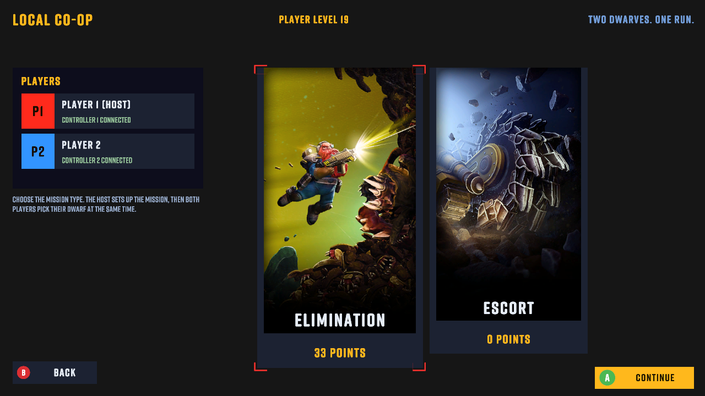
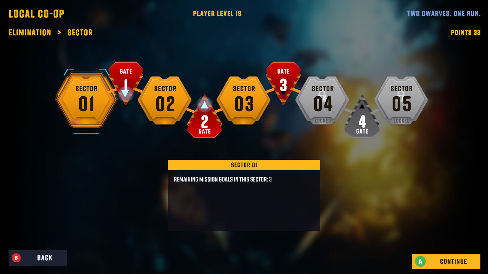
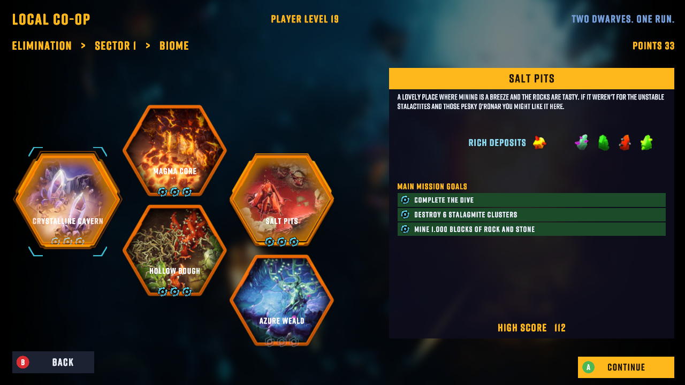
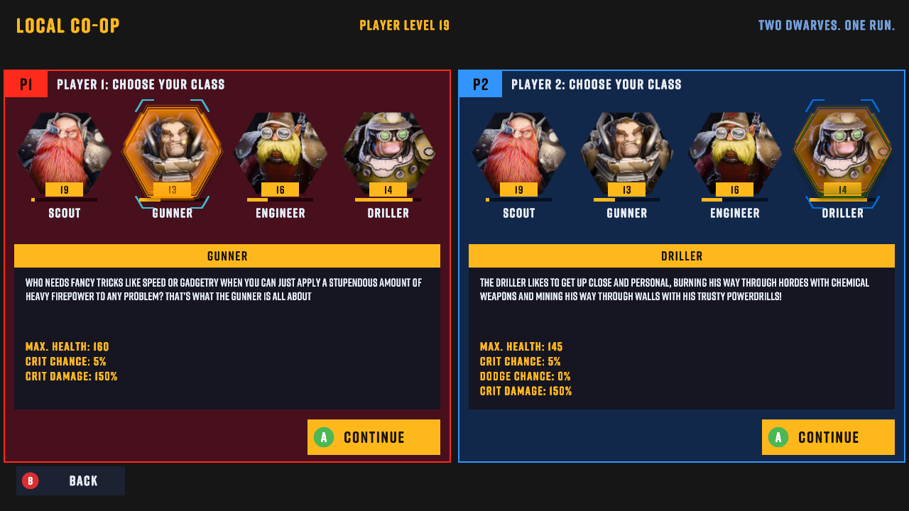
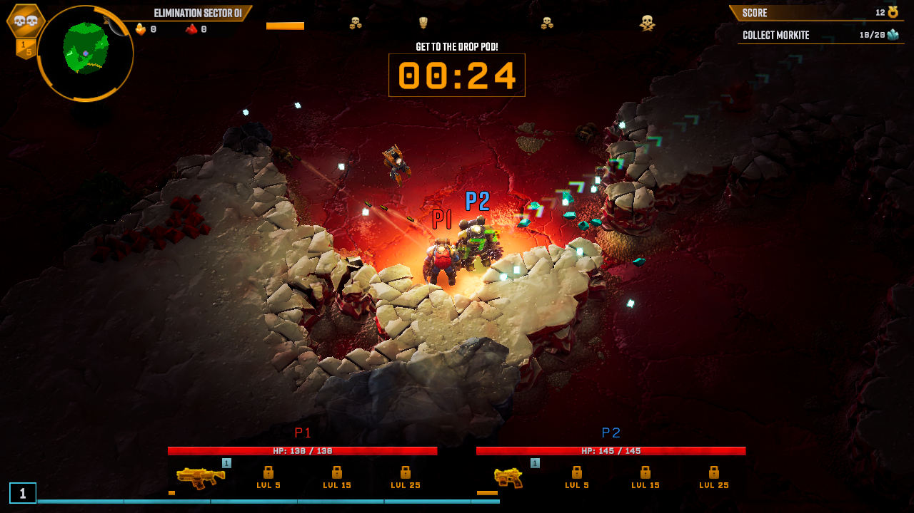
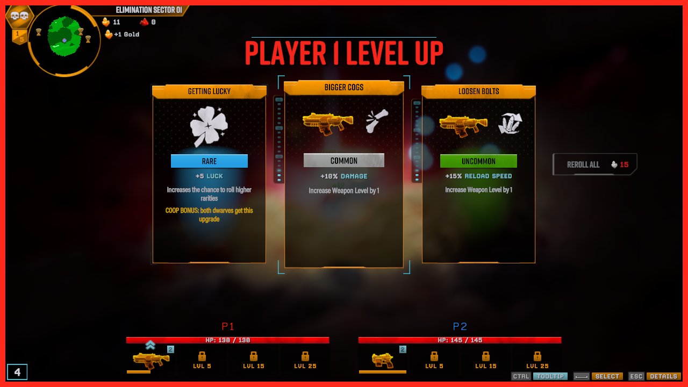
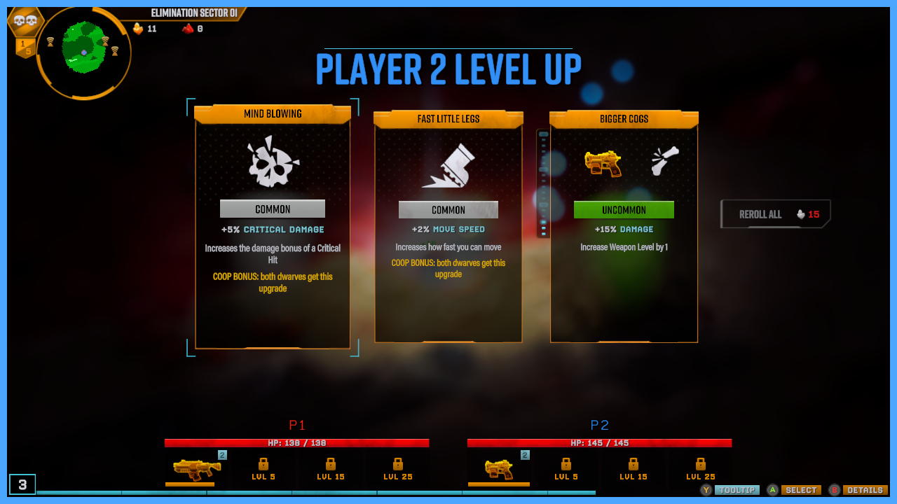
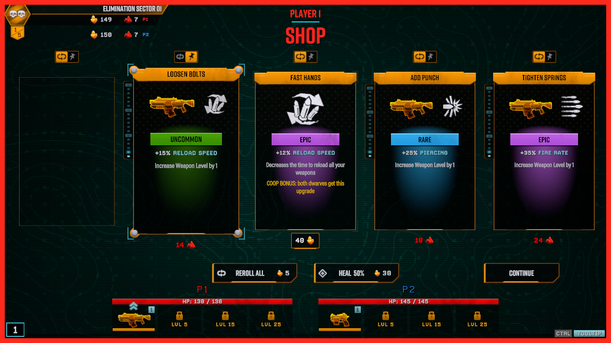
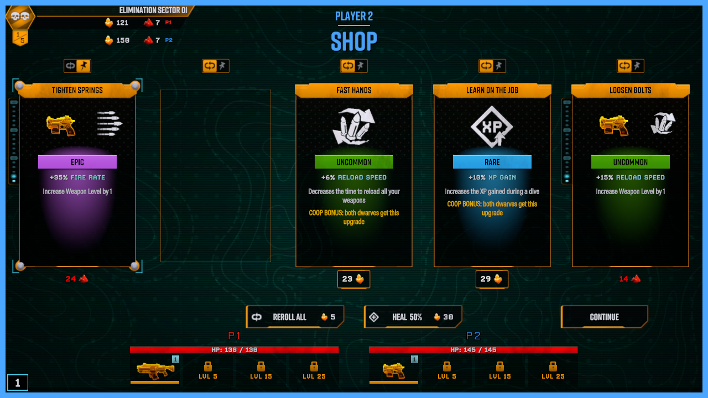

# Deep Rock Galactic: Survivor - Local Co-op

Two dwarves in one game, on one PC, with two controllers. A BepInEx 6 (IL2CPP) plugin with Harmony patches for Unity 6. There is no network code:
the second dwarf is a second player object inside the same game process. Playing online with a friend works through Steam Remote Play Together
(see "Online" below).

**Version 1.0.0. Status: playable.** Supported mission types: **Elimination** and **Escort**. Full runs (stages, shop, end screen, retry) have been
played by hand with two controllers. Other mission types are not offered by the co-op menu and are not tested. Known gaps are listed at the end.
It replaces the stopped online prototype [drg-survivor-coop](https://github.com/Reudo/drg-survivor-coop).

Not affiliated with Funday Games or Coffee Stain. You need the game; this repo contains no game files.

## What you get

**Own co-op menu, made for controllers.** The main menu gets a "LOCAL CO-OP" entry. Mouse is optional; every page works with the controllers alone.
- Lobby, mission type (Elimination / Escort), sector, biome and danger level, then **both players choose class and subclass at the same time**
  (player 1 left, player 2 right), player 2 presses READY, player 1 starts the run.
- With two controllers each pad has a role: controller 2 only moves over player 2's choices, controller 1 over everything else.
  D-pad or left stick moves, **A** selects, **B** goes one page back (or undoes CONFIRM), the **menu button** goes on (CONTINUE, CONFIRM, READY, START RUN).
  The buttons show these symbols. With one controller that pad does everything.
- German and English, following the game's language setting.

**Two dwarves in the run.**
- Shared camera, shared experience, one run: it ends when both dwarves are down. Player 1 is shown red, player 2 blue (tags over the dwarves, health bars,
  minimap markers).
- Two HUD panels at the bottom: player 1 left (the game's own), player 2 right, each with its own health bar and weapon slots.
- Separate wallets and **one shop round per player**, one after the other. Level-ups alternate between the players; while it is somebody's turn the
  other controller cannot confirm anything. Level-up screens show the player in a banner, the shop and the pause menu show "PLAYER n" above their
  title in the player's colour.
- **Pause menu per player**: player 1's pause button opens player 1's weapons, artifacts, stats and class; player 2's Start button opens player 2's.
  Only the controller that opened it drives it.
- **Revive**: a dwarf that dies lies still; the other one stands next to it for a few seconds (ring on the ground) and it gets up with part of its health.
  Enemies go for the dwarf that is up. Switch it off with the REVIVE button on the last menu page.
- Artifacts and general stat upgrades ("COOP BONUS") count for both dwarves; weapons and weapon upgrades stay with the dwarf that chose them.
- Both dwarves can use what the game builds around "the player": supply-pod and excavation circles, healing pillars, the bounce mushroom, the
  escort mission's drilldozer circle, magma floor and explosion damage, damage numbers, loot crates, XP orbs (small and large), pickups.
- The drop pod at the end of a stage leaves when **both** dwarves stand inside it.
- Rumble per controller, controller hints, a second minimap marker.

## Screenshots
Taken by the test harness from the real game (the game's own texts are English here, the plugin follows the game's language).

| | |
|---|---|
|  |  |
| Lobby: both players, choose the mission | Sector and gate |
|  |  |
| Biome | Both players choose their class at the same time (red = player 1, blue = player 2) |
|  |  |
| In the run: two dwarves, two panels, two pointer arrows | Level-up of player 1 |
|  |  |
| Level-up of player 2 | Shop of player 1 (own gold) |
|  | |
| Shop of player 2 (own gold) | |

## Install

Play with the installer package `DrgSurvivorLocalCoop-1.0.0-Installer.zip` (it is the release file, not stored in the repo; built with `tools/build-installer.ps1`). It contains the plugin, the installer scripts and a copy of BepInEx for PCs that have none. Extract the ZIP completely and double-click
`Install-LocalCoop.bat`. It finds the Steam folder, backs up your save, installs BepInEx only if there is none, copies the plugin, and creates the
shortcut "DRG Survivor Co-op". BepInEx is switched off for normal starts, so single player stays the unchanged game. `installer/README.txt`
(English) and `installer/LIES-MICH.txt` (German) have the details; `Uninstall-LocalCoop.bat` removes everything again.

Co-op runs count in your normal profile (hence the save backup at installation).

Settings: `BepInEx\config\localcoop-settings.txt` (revive mode, health and time, an experimental second drone, debug mode).

## Online (Steam Remote Play Together)

The game's store page does not offer "Remote Play Together", Spacewar does. The installer can replace Spacewar's exe with a tiny launcher that starts
the game in co-op mode; then you invite your friend from Spacewar. Player 2 is the most recently connected gamepad (the guest's). Three conditions
(BepInEx console off, controller profile "Gamepad" in the Steam overlay, start Spacewar, not the game) are written down in `installer/README.txt`.
The invite works and a full run was played this way; the guest's pad on every single screen is not tested systematically.

## Known gaps
- The end-screen weapon overview does not list player 2's damage, and the damage numbers on the end screen are probably not accurate.
- DLCs are not supported at the moment, and the game was not tested with DLCs active.
- Drones: both dwarves share one drone by default; a second drone for player 2 is an experiment. Turrets of player 2 deal damage (hand-tested).
- Only Elimination and Escort; other mission types are not offered.
- Remote Play: see above.
- The thin dark red mark at the right end of the health bars is part of the game's own bar frame.

## Layout
- `LocalCoop/` - the plugin (C#, `LocalCoop.csproj`; set `GameDir` to a game folder with BepInEx and generated interop assemblies).
- `installer/` - `Install-LocalCoop.bat/.ps1`, `payload/` (uninstaller, `Start-Coop.bat`, Remote Play trick), English `README.txt`, German `LIES-MICH.txt`.
- `rplauncher/` - `RpLauncher.cs` (tiny launcher that replaces Spacewar's exe) and the enable/undo scripts.
- `tools/` - test harness and build scripts (`new-test-copy.ps1` makes the test copy of the game, `lc-run.ps1` runs one test, `batch_*.ps1` run checks with their twins, `build-installer.ps1` builds the package). They work on the test copy in `work\game-lc` (git-ignored); never run them on your real install.
- `SETUP.md` - from a fresh clone to a green test run.
- `PLAN.md` - decisions and measured results.

## How it is tested
`tools/lc-run.ps1` starts a test copy of the game with the plugin, scripted menu clicks and virtual gamepads, and judges log lines and screenshots.
Every check has a **twin** (a launch flag `-lcno...` that switches the feature off) that must turn it red; saves are backed up and restored byte for byte.
A green run is not acceptance: what needs real controllers is checked by hand by the owner.

## Not in this repo
No game files, no BepInEx and no built binaries in the repository itself (`*.dll`, `*.exe`, `*.zip` are ignored). The release ZIP is built from it with `tools/build-installer.ps1` and contains the plugin and the unchanged BepInEx 6.0.0-be.789 package; it is the only place BepInEx appears. The owner's private working notes (hand-test list, goal list) are not part of the repo either.

## License
The code in this repository is MIT licensed (`LICENSE`). The release ZIP also contains BepInEx, which has its own license; see `THIRD-PARTY-NOTICES.txt`.

## Rules for contributors
Work on a copy of the game, never on the Steam install or saves. Every check needs a twin that makes it fail. A green run is not acceptance.
